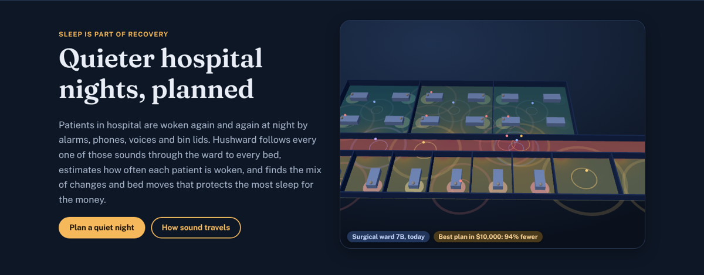
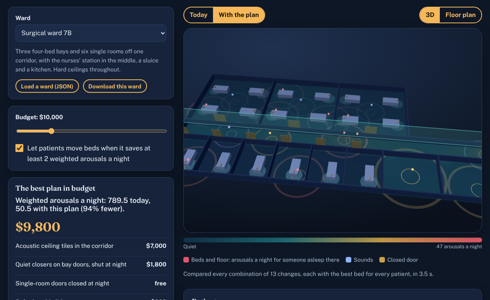

# Hushward

**Quieter hospital nights, planned.** Hushward follows every night-time sound in a ward (alarms, phones, voices, bin lids, the sluice) through rooms, doorways and the corridor to every bed. It estimates how often each patient is woken, then finds the mix of changes and bed moves that protects the most sleep for the money.

**Live:** https://reihooneh.github.io/hushward/



Built with AssemblyScript compiled to WebAssembly (no imports) and three.js. The engine combines room acoustics (image sources and Sabine reverberation), a probabilistic waking model, the Hungarian algorithm and an exhaustive budget search with a Pareto frontier. Field: health care environments and patient sleep, plus acoustics and operations research.

## Why

Poor sleep in hospital slows recovery and raises the risk of delirium, and much of it is caused by noise. Studies have recorded patients being woken by alarms and voices at levels well below what staff notice. Wards try quiet hours, earplugs and new ceilings, but rarely know which change helps whom, how much, or whether simply moving the most vulnerable patients would do more. Hushward makes that a question you can answer before spending anything.

## What it does

- **Sound to every pillow:**
  - **Inside a room:** the direct sound, every reflection off walls, floor and ceiling up to second order (image-source method, 25 paths), and the lingering echo (Sabine's diffuse field). Ceilings, curtains and furnishings absorb.
  - **Between rooms:** sound leaves through the doorway (diffuse-field power through an opening), travels along the corridor, and enters other rooms. A closed door takes off a further 25 dB.
- **Chance of waking:** each event's level at the pillow becomes a probability from an S-shaped curve. Alarms wake people more easily than voices. Patients at risk of delirium, recovering from surgery, at the end of life, or light sleepers have lower thresholds and count for more.
- **Who sleeps where:** for any set of changes, the Hungarian algorithm finds the bed for every patient that minimises total weighted arousals. A bed move is only made if it saves at least 2 a night.
- **The best plan in budget:** every combination of up to 14 changes is tried (tiles, door closers, soft-close bins, pagers, moving the night handover, a quieter phone), each with patients reassigned. It keeps the best plan within the budget and the whole frontier of what each extra dollar buys.
- **It shows it:**
  - a 3D ward at night, where beds glow by how often their patient is woken, sounds pulse where they start, and closed doors and acoustic ceilings appear;
  - a floor plan painted with how disruptive each spot would be for a sleeper, with arrows for bed moves;
  - a patient table, today against the plan;
  - an interactive explainer of how sound travels in a room.

## Pages

| Page | What's on it |
|---|---|
| [Home](https://reihooneh.github.io/hushward/) | The example ward planned live in your browser, in 3D |
| [Plan a quiet night](https://reihooneh.github.io/hushward/planner.html) | The planner: two example wards or your own (JSON), budget, bed moves, changes you'd consider, the frontier chart, 3D and floor plan, patients |
| [How sound travels](https://reihooneh.github.io/hushward/sound.html) | Drag a sound and a pillow around a room. See the image sources, the direct, early and reverberant parts, and the chance of waking; plus level against distance for two ceilings |
| [How it works](https://reihooneh.github.io/hushward/method.html) | The method, tests, limits and references |



## Run it

```bash
npm ci
npm run build          # AssemblyScript -> WebAssembly, then the site
npm test               # physics with known answers, optimisers against brute force, hostile input
npx playwright install chromium && npm run test:web   # every page at three sizes
npm run serve          # http://127.0.0.1:4173/
```

## Tests

- **Physics.**
  - In a nearly fully absorbing room, doubling the distance takes off 6 dB, and the direct level at 1 m is 11 dB below the sound power.
  - The reverberation time equals Sabine's formula.
  - Acoustic tiles help more far from a sound than near it.
  - Closing a door lowers sound from another room by exactly its extra 23 dB (46 dB through two closed doors).
  - The WebAssembly core matches an independent JavaScript room model to 0.01 dB.
- **Brute force.** On 40 random wards, for every combination of changes, the bed assignment must match trying every arrangement of patients. At four budgets, the best plan must match the best of every combination evaluated directly. The frontier must be cheapest-first and strictly improving.
- **Browser.**
  - Every page is checked at phone, tablet and desktop sizes for errors, sideways scrolling, overlapping text or controls, and SVG drawn outside its box.
  - The planner is driven end to end, and hostile ward files are loaded.
  - The explainer's controls are checked.
  - Every built page is checked for its strict CSP and for having no inline code.

## Security

See [SECURITY.md](SECURITY.md). In short:

- **Static site:** everything runs in the browser, with no server, account, tracking or third-party scripts.
- **Strict CSP:** `default-src 'none'`, nothing inline, and `'wasm-unsafe-eval'` only for its own WebAssembly.
- **No HTML from strings:** the pages are built with DOM calls only, and a test enforces it.
- **Untrusted ward files:** they are size-capped, strictly validated (unknown fields, `__proto__`, non-finite numbers, points outside rooms, markup in names) and never echoed.
- **The core:** it re-validates every number, uses fixed buffers, has no imports, and its search is bounded.
- **Dependencies:** pinned and audited in CI.
- **Invented data:** the example patients are made up; don't put real patient data in a ward file.

## Limits

- **Simplified rooms:** they are boxes with evenly absorbing surfaces, and sound through walls and ceiling voids isn't modelled.
- **Illustrative numbers:** the waking curve, sound powers and event counts are estimates for comparing options; measure a real ward first.
- **Noise only:** bed moves consider noise only, and clinical needs come first.
- **Prices:** they are rough.

## Files

| Path | What it is |
|---|---|
| `assembly/index.ts` | The core: input checks, options, room acoustics, doorways, waking, Hungarian algorithm, budget search, heat map |
| `src/web/model.js` | Ward descriptions: validation, sound kinds and patient needs, the numbers for the core, and a JavaScript room model |
| `src/web/*.js`, `src/pages/*.html`, `src/css/site.css` | The site: worker, 3D scene, floor plan, pages |
| `wards/*.json` | The example wards |
| `tests/` | Engine and browser tests |

More detail: [HOW-IT-WORKS.md](HOW-IT-WORKS.md).

## License

MIT. three.js (MIT), Fraunces and Public Sans (SIL OFL) are vendored with their licences.
